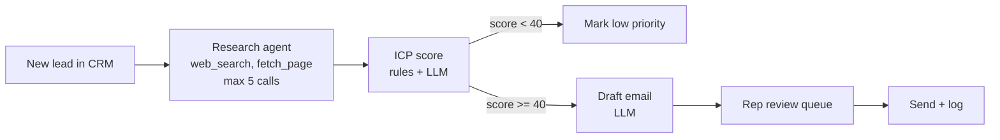

# Case Study 00 — Worked Example: "Our sales reps waste too much time on bad leads"

A short walk through the framework, to show what "good" looks like. The numbers are illustrative.

## 1. Problem as given
> "Our sales reps waste too much time on bad leads. Can we use AI agents for this?"

## 2. Outcome & metric
- **Who:** 8 SDRs (sales development reps) at a B2B SaaS company; the sales manager pays for the fix.
- **Job:** decide which inbound leads to contact first, and what to say to them.
- **Metric:** SDR hours spent on leads that never convert (est. 40% of time) → under 15%. Secondary: lead-to-meeting rate stays flat or rises.
- **Good enough:** a ranked list that a rep trusts at least 80% of the time.

## 3. Current process
| # | Step | Actor | Systems | Volume / time | Pain |
|---|---|---|---|---|---|
| 1 | Lead arrives (form/webinar) | System | CRM | 300/day | — |
| 2 | Look up company: size, industry, tech | SDR | LinkedIn, website | 5–10 min each | **Slow, repetitive** |
| 3 | Decide whether it fits our ICP (ideal customer profile) | SDR | Head knowledge | 1 min | Inconsistent between reps |
| 4 | Write a personalised first email | SDR | Email | 10 min | Slow |
| 5 | Send + log in CRM | SDR | CRM/email | 1 min | — |

**Bottleneck:** steps 2 and 4 (≈ 15–20 min × 300 leads/day is far more than 8 reps can do, so leads go stale).

## 4. Step classification
| # | Step | Type | Why |
|---|---|---|---|
| 2 | Company research | **Agent** (bounded) | The path varies: sometimes the website is enough, sometimes it needs news or a jobs page |
| 3 | ICP fit scoring | **Code + single LLM call** | ICP rules are mostly deterministic (size, industry, region); the LLM only reads fuzzy signals |
| 4 | Draft email | **Single LLM call** | Fixed output shape, inputs come from step 2 |
| 5 | Send | **Human** | Reputation risk; the rep approves |

Notice that only one step is a real agent. The overall system is a **workflow with one agentic step inside it.**

## 5. Architecture
- **Pattern:** a prompt chain (`SequentialAgent`) → research step as a bounded agent (max 5 tool calls) → scoring → draft → human review queue.
- **Why not simpler:** a single LLM call can't do research because it needs live data from several sources. **Why not more complex:** the steps are always the same, so an orchestrator-workers or multi-agent setup adds cost and nothing else.

- **Models:** small model for scoring and drafting, mid-tier model for research.

## 6. Tools & data
| Tool | R/W | Reversible | Idempotent | Blast radius | Auth |
|---|---|---|---|---|---|
| `web_search` | R | — | yes | low (cost) | API key |
| `fetch_page` | R | — | yes | **prompt injection from page content** | none |
| `crm_update_lead` | W | yes (field update) | yes (upsert) | wrong score on a lead | service account, fields scoped |
| `send_email` | W | **no** | no | brand damage | **human only** |

## 7. Evals
- **Research:** 50 past leads with known facts → check extracted size/industry against the truth (assertions).
- **Scoring:** the same 50 leads labelled won/lost/never-replied → does the score rank winners above losers? (AUC)
- **Drafts:** LLM-as-judge on a rubric (personalised, accurate, no invented facts), calibrated on 20 drafts the sales manager graded.
- **Baseline:** current rep ordering (first in, first out).

## 8. Risks & guardrails
| Risk | Guardrail |
|---|---|
| Email states a hallucinated fact about the prospect | The draft may only cite facts from the research output; a judge check flags unsupported claims |
| Prompt injection from fetched web pages | Page content is treated as data; the research agent has no write tools |
| Reps stop trusting the scores | Show the reasoning plus sources alongside each score |

## 9. Cost, latency, ROI
- ~15k tokens/lead × 300/day ≈ 4.5M tokens/day → a modest monthly bill on small/mid models (work out the exact figure from current pricing).
- Batch job, so latency doesn't matter (a few minutes per lead is fine).
- Saves about 12 min × 300 leads/day of rep time → clearly positive ROI.

## 10. Rollout
| Stage | Unlock criteria |
|---|---|
| Shadow (2 wks) | The agent scores leads, reps work as usual; compare the rankings |
| Assist | Score AUC ≥ 0.7 vs. outcomes; drafts approved at ≥ 70% |
| Partial auto | Auto-deprioritise leads scoring < 20 once that has been ≥ 95% correct |
| Full auto | Never for sending: a human always presses "send" |

## 11. Open questions
- Is CRM outcome data clean enough to label the eval set?
- Does legal allow automated web research on prospects in every region we sell to?

## 12. Verdict
**Build it as a workflow with one bounded agentic step.** The value comes from automated research and first drafts, not from autonomy. Sending stays human.
