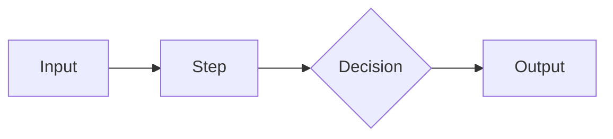

# Solution Design — <Name>

> Copy this file into a case study or into `05_projects/pN_*/docs/design.md`. Keep each section short. Gaps you can't fill are findings too: write them down.

**Date:** · **Status:** draft / reviewed / built

## 1. Problem as given
> <the vague brief, word for word>

## 2. Outcome & metric
- Who:
- Job to be done:
- Metric (today → target):
- "Good enough" threshold:

## 3. Current process (as-is)
| # | Step | Actor | Systems | Volume / time | Pain |
|---|---|---|---|---|---|
| 1 | | | | | |

Bottleneck(s):

## 4. Step classification
| # | Step | Code / LLM call / Workflow / Agent / Human | Why |
|---|---|---|---|

## 5. Architecture
- Pattern chosen:
- Why not the simpler rung below:
- Diagram:

- Models per step:

## 6. Tools & data
| Tool | Read/Write | Reversible? | Idempotent? | Blast radius | Auth |
|---|---|---|---|---|---|

Data sources & freshness:

## 7. Evals
- Success criteria:
- Eval set (size, source, edge cases):
- Scoring method:
- Baseline:

## 8. Risks & guardrails
| Risk | Likelihood | Impact | Guardrail |
|---|---|---|---|

## 9. Cost, latency, ROI
- Cost per task × volume = monthly:
- Latency budget:
- ROI estimate:

## 10. Rollout
| Stage | Unlock criteria |
|---|---|
| Shadow | |
| Assist | |
| Partial auto | |
| Full auto | |

## 11. Open questions / assumptions
-

## 12. Verdict
Agent / workflow / plain code / don't build, plus one paragraph explaining why.
