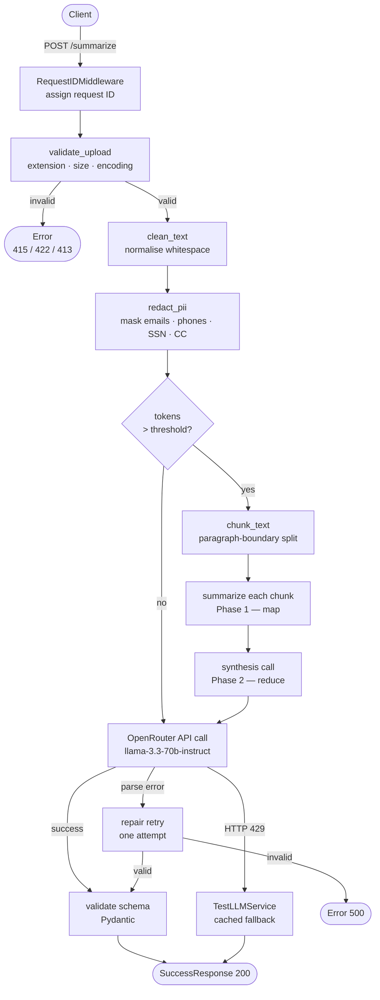

# Mini AI Document Summary API

A FastAPI service that accepts a `.txt` file upload, preprocesses the text (including optional PII redaction), and returns a structured AI-generated summary using **`meta-llama/llama-3.3-70b-instruct:free`** via [OpenRouter](https://openrouter.ai).

---

## Quick Start

### 1. Clone & install dependencies

```bash
pip install -r requirements.txt
```

### 2. Configure environment variables

```bash
cp .env.example .env
# Open .env and set OPENROUTER_API_KEY
```

### 3. Run the server

```bash
uvicorn main:app --reload
```

The API will be available at `http://localhost:8000`.
Interactive docs: `http://localhost:8000/docs`

---

## Request Lifecycle



---

## Environment Variables

| Variable | Required | Default | Description |
|---|---|---|---|
| `OPENROUTER_API_KEY` | **Yes** | — | Your OpenRouter API key |
| `OPENROUTER_BASE_URL` | No | `https://openrouter.ai/api/v1` | OpenRouter endpoint |
| `MODEL_SLUG` | No | `meta-llama/llama-3.3-70b-instruct:free` | Model identifier |
| `HTTP_REFERER` | No | `""` | Optional attribution header for OpenRouter |
| `X_OPENROUTER_TITLE` | No | `""` | Optional attribution header for OpenRouter |
| `LLM_TIMEOUT_SECONDS` | No | `45` | HTTP timeout per LLM call |
| `LLM_MAX_OUTPUT_TOKENS` | No | `1024` | Max tokens in LLM response |
| `LLM_TEMPERATURE` | No | `0.3` | Sampling temperature (lower = more deterministic) |
| `MAX_FILE_SIZE_MB` | No | `2` | Maximum upload size in MB |
| `CHUNK_TOKEN_THRESHOLD` | No | `100000` | Token count above which chunking is triggered |
| `ENABLE_PII_REDACTION` | No | `true` | Toggle PII redaction before sending to OpenRouter |
| `RATE_LIMIT_PER_MINUTE` | No | `10` | Max requests per client IP per minute on `/summarize` |

---

## API Endpoints

### `POST /summarize`

Upload a `.txt` file and receive an AI-generated summary.

**Request:** `multipart/form-data` with a `file` field.

**Success response (200):**
```json
{
  "status": "success",
  "filename": "sample.txt",
  "summary": {
    "title": "Short title of the document",
    "summary": "A concise paragraph summarising the document.",
    "key_points": [
      "Important point 1",
      "Important point 2",
      "Important point 3"
    ]
  }
}
```

**Error responses:**

| Status | Condition |
|---|---|
| `413` | File exceeds 2 MB |
| `415` | Not a `.txt` file or content looks binary |
| `422` | Empty file or undecodable content |
| `429` | Client rate limit exceeded |
| `500` | Unexpected server error |

All errors use:
```json
{ "status": "error", "message": "..." }
```

### `GET /health`

Lightweight liveness probe — no live LLM call.

```json
{
  "status": "ok",
  "model": "meta-llama/llama-3.3-70b-instruct:free",
  "api_key_configured": true,
  "pii_redaction_enabled": true
}
```

---

## Design Decisions

### Why OpenRouter over a local model?

| Factor | OpenRouter | Local inference |
|---|---|---|
| Hardware requirement | None | GPU recommended |
| Setup complexity | Set one env var | Install model, runtime |
| Model swapping | Change `MODEL_SLUG` | Re-download |
| Data privacy | **Prompts may be logged** (see below) | Data stays local |
| Free-tier limits | 20 req/min, 50 req/day | Unlimited |

**Chosen model:** `meta-llama/llama-3.3-70b-instruct:free`
- Stable since December 2024 — unlikely to be pulled unexpectedly.
- General-purpose instruction-following — well-suited to summarisation (not coding/agentic-specialised).
- Open-weight (Meta Llama license).
- 131K token context window — comfortable headroom over the 2 MB input cap.
- Temperature set to **0.3** (below the conversational default) for consistent, deterministic output.

### Why PII redaction before sending to OpenRouter?

Free-tier OpenRouter models (and their underlying providers) **may retain prompts and completions for model improvement**. Because this service sends user documents to an external third party, a pre-LLM PII scan/redaction step is included:

- Patterns detected: email addresses, US phone numbers, SSN-like patterns (`NNN-NN-NNNN`), credit card number groups.
- Matched values are **replaced** (not silently deleted) with labelled tokens — e.g. `[REDACTED_EMAIL]` — to preserve document structure for summarisation.
- Only per-category **counts** are logged; actual PII values are never written to logs.
- Togglable via `ENABLE_PII_REDACTION=false` for demonstration or trusted-content scenarios.

### Chunking strategy

Long documents are split using a **token-aware map-reduce** approach:

1. Count tokens with `tiktoken` (`cl100k_base` — close approximation for Llama 3).
2. If total tokens ≤ `CHUNK_TOKEN_THRESHOLD` (default 100K), send as a single call.
3. Otherwise split on paragraph boundaries; if a single paragraph exceeds the threshold, fall back to sentence boundaries.
4. **Phase 1:** Summarise each chunk individually.
5. **Phase 2:** A synthesis LLM call merges all per-chunk summaries into one coherent final summary with deduplicated key points.

### Rate limiting

The `/summarize` endpoint is rate-limited **twice**:
1. **ASGI layer** (`ContentSizeLimitMiddleware`): rejects oversized uploads before any parsing.
2. **Application layer** (`slowapi`): `RATE_LIMIT_PER_MINUTE` requests per client IP — protects the daily OpenRouter quota from a single client exhausting it.

---

## Data Policy Notice

> **⚠️ Important:** This service sends document content to OpenRouter, a third-party API. Free-tier OpenRouter models may log prompts and completions for provider-side model improvement. **Do not upload documents containing sensitive personal data** unless `ENABLE_PII_REDACTION=true` (the default) and you have verified the redaction output meets your requirements. For sensitive workloads, consider a paid OpenRouter tier with data retention opt-outs, or a fully local model.

---

## Known Limitations

- **Free-tier quality ceiling:** `meta-llama/llama-3.3-70b-instruct:free` is capable but may be inconsistent on very short or highly technical documents.
- **Rate limit behaviour:** OpenRouter's free tier allows 20 requests/minute and 50 requests/day (or 1000/day with ≥$10 credits). Under load, clients will receive a cached fallback response rather than an error.
- **No persistent job queue:** The API is synchronous — summarisation happens within the HTTP request. Large documents with many chunks may take 30–90 seconds.
- **Regex-based PII detection:** The current patterns catch common formats but are not exhaustive. Names, addresses, and organisation-specific identifiers are not detected.

---

## What You'd Change for Production

| Area | Current | Production |
|---|---|---|
| Job handling | Synchronous request/response | Async job queue (Celery / ARQ) with status polling |
| LLM reliability | Free-tier with cached fallback | Paid OpenRouter tier or self-hosted fallback |
| PII detection | Regex patterns | NER-based model (spaCy / Presidio) |
| Rate limiting | In-memory (resets on restart) | Redis-backed (persistent, multi-instance) |
| Storage | None | Persistent store for job results and audit logs |
| Auth | None | API key or OAuth2 for endpoint access control |

---

## Project Structure

```
doc_summarize_api/
├── main.py                          # FastAPI app factory
├── requirements.txt
├── .env.example                     # Environment variable template
├── .gitignore
├── README.md
└── app/
    ├── config.py                    # Pydantic BaseSettings (all env vars)
    ├── models/
    │   └── response_models.py       # SuccessResponse, ErrorResponse, SummaryDetail
    ├── api/
    │   ├── health_api.py            # GET /health
    │   └── summarize_api.py         # POST /summarize (orchestration + rate limit)
    └── services/
        ├── logger_service.py        # JSON logger + RequestIDMiddleware
        ├── file_service.py          # Upload validation
        ├── text_processing_service.py # Clean, PII redact, chunk
        └── llm_service/
            ├── base_llm_service.py  # ABC + custom exceptions
            ├── openrouter_llm_service.py  # Live OpenRouter client
            └── test_llm_service.py  # Cached fallback (429 / test mode)
```
